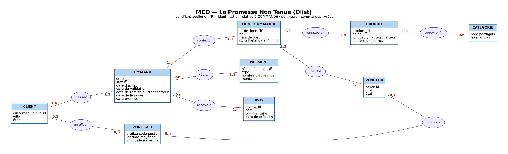
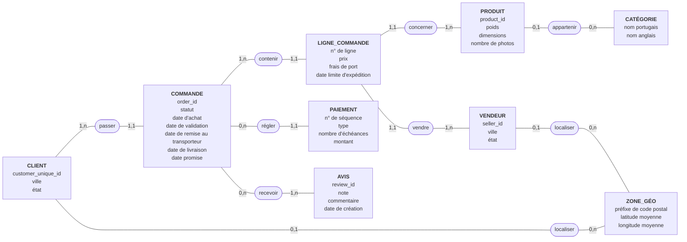
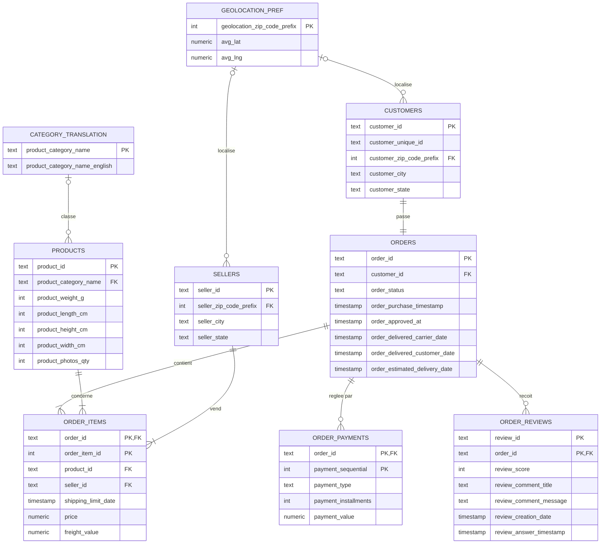
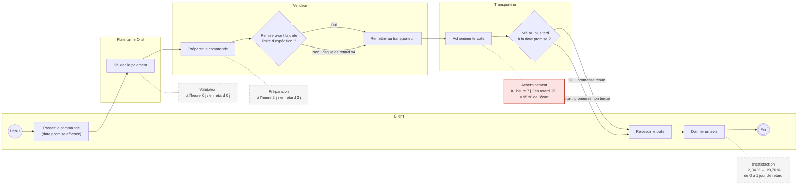
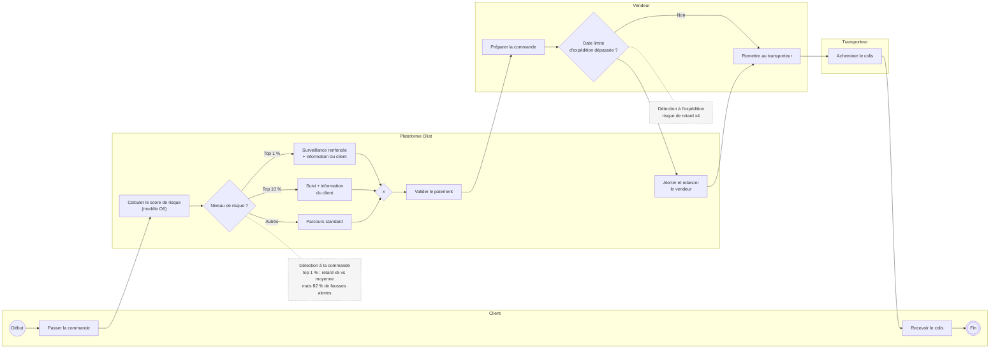

# Modélisation — La Promesse Non Tenue

Trois vues complémentaires du même système :

- le **MCD** décrit *ce qui existe* (les objets métier et leurs liens) ;
- le **MLD** décrit *comment c'est stocké* (les tables et leurs clés) ;
- le **BPMN** décrit *comment ça se déroule* (le parcours d'une commande, et où naissent les retards).

> Les diagrammes sont écrits en Mermaid : GitHub les affiche directement.
> ⚠️ Noms de colonnes à vérifier sur les tables `staging` avant publication.

---

## 1. MCD — Modèle Conceptuel de Données

Périmètre : commandes livrées (RG-01).

*Version image ci-dessus ; version Mermaid ci-dessous.*

### Ce que traduisent les cardinalités

Chaque cardinalité s'appuie sur un fait vérifié dans les données.

| Association | Cardinalités | Fait observé |
|---|---|---|
| CLIENT – passer – COMMANDE | 1,n / 1,1 | Une personne peut commander plusieurs fois ; une commande n'a qu'un client |
| COMMANDE – contenir – LIGNE | 1,n / 1,1 | Toute commande livrée contient au moins un article |
| LIGNE – concerner – PRODUIT | 1,1 / 1,n | Un produit peut être vendu plusieurs fois |
| LIGNE – vendre – VENDEUR | 1,1 / 1,n | Une commande peut mêler plusieurs vendeurs (`nb_sellers`, RG-09) |
| PRODUIT – appartenir – CATÉGORIE | 0,1 / 0,n | 1 392 commandes portent un produit sans catégorie |
| COMMANDE – régler – PAIEMENT | 0,n / 1,1 | Paiement fractionnable ; 1 commande n'a aucune ligne de paiement |
| COMMANDE – recevoir – AVIS | 0,n / 1,n | 646 commandes sans avis, 547 avec plusieurs ; un même `review_id` peut couvrir plusieurs commandes *(à vérifier)* |
| CLIENT / VENDEUR – localiser – ZONE_GÉO | 0,1 / 0,n | Certains codes postaux sont absents de `geolocation` → 476 distances incalculables |

### Deux choix de modélisation

**LIGNE_COMMANDE est une entité, pas une association.** Une association ternaire COMMANDE–PRODUIT–VENDEUR serait identifiée par le trio (commande, produit, vendeur). Or un même produit d'un même vendeur peut apparaître sur plusieurs lignes d'une commande : c'est ainsi que le dataset représente la quantité. Il faut donc un identifiant propre, le numéro de ligne. C'est aussi pourquoi `nb_items` se calcule avec `COUNT(*)` et non `SUM(order_item_id)`.

**CLIENT est identifié par `customer_unique_id`.** Dans les données, `customer_id` change à chaque commande : c'est un identifiant technique, pas une personne. Le MCD modélise la réalité métier (une personne passe plusieurs commandes) ; le MLD, lui, garde la structure physique du dataset.

---

## 2. MLD — Modèle Logique de Données

### Notation relationnelle

Clé primaire <u>soulignée</u>, clé étrangère précédée de `#`.

- **customers** (<u>customer_id</u>, customer_unique_id, #customer_zip_code_prefix, customer_city, customer_state)
- **orders** (<u>order_id</u>, #customer_id, order_status, order_purchase_timestamp, order_approved_at, order_delivered_carrier_date, order_delivered_customer_date, order_estimated_delivery_date)
- **order_items** (<u>#order_id, order_item_id</u>, #product_id, #seller_id, shipping_limit_date, price, freight_value)
- **products** (<u>product_id</u>, #product_category_name, product_weight_g, product_length_cm, product_height_cm, product_width_cm, product_photos_qty)
- **category_translation** (<u>product_category_name</u>, product_category_name_english)
- **sellers** (<u>seller_id</u>, #seller_zip_code_prefix, seller_city, seller_state)
- **order_payments** (<u>#order_id, payment_sequential</u>, payment_type, payment_installments, payment_value)
- **order_reviews** (<u>review_id, #order_id</u>, review_score, review_comment_title, review_comment_message, review_creation_date, review_answer_timestamp)
- **geolocation_pref** (<u>geolocation_zip_code_prefix</u>, avg_lat, avg_lng)

### Schéma

### Passage du MCD au MLD

- Chaque **entité** devient une table ; son identifiant devient la clé primaire.
- Une association **1,n – 1,1** disparaît : la clé du côté « n » migre en clé étrangère du côté « 1,1 » (ex. `order_id` dans `order_items`).
- **Écart assumé avec le MCD** : la table `customers` est au grain `customer_id` (une ligne par commande), d'où la relation 1–1 avec `orders`. Pour suivre un client dans le temps, il faut passer par `customer_unique_id`.
- **Les clés étrangères vers `geolocation_pref` ne sont pas contraintes** : des codes postaux clients et vendeurs n'y figurent pas. D'où les jointures en `LEFT JOIN` dans tout le pipeline.
- `geolocation_pref` est une table construite (couche `intermediate`) : la table brute `geolocation` contient plusieurs coordonnées par préfixe, agrégées ici en moyenne.

---

## 3. BPMN — Processus actuel (AS-IS)

Le parcours d'une commande, avec les durées observées par segment (O2).

**Lecture.** Le retard naît presque entièrement chez le **transporteur** : l'acheminement passe de 7 à 26 jours entre une commande à l'heure et une commande en retard. Le vendeur ajoute un jour. Le seul signal précoce observable est le dépassement de la date limite d'expédition, mais il n'est connu qu'au moment de la remise.

---

## 4. BPMN — Processus cible proposé (TO-BE)

Deux points de détection : à la **commande** (modèle O6) et à l'**expédition** (date limite dépassée).

**Lecture.** À la commande, le modèle ne justifie que des actions **peu coûteuses** (surveillance, information du client) : même dans le top 1 %, 82 % des alertes sont fausses. Le second point de contrôle, à l'expédition, porte un signal plus fort, mais plus tardif.

**Limites.** Les paliers (top 1 %, top 10 %) sont des propositions : le coût réel des actions n'est pas disponible dans les données. Le modèle a été évalué sur juin-août 2018 uniquement.
