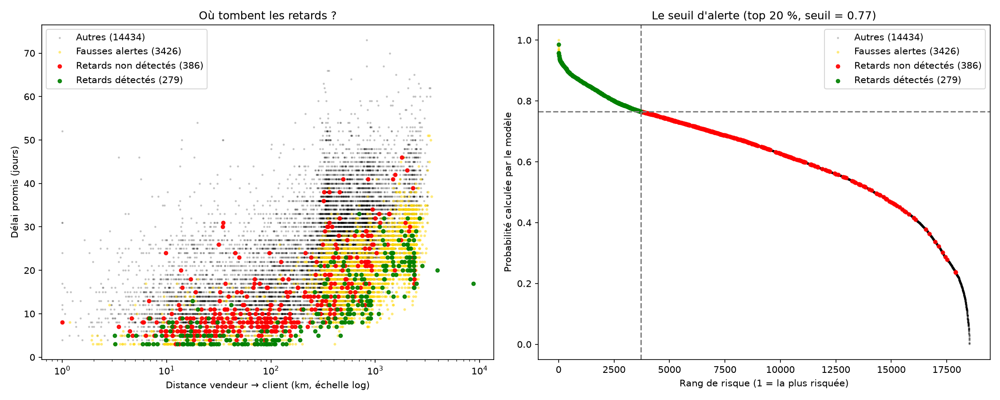

# O6 — Constats : peut-on anticiper le retard au moment de la commande ?

**Périmètre :** `mart.orders`, 96 447 commandes livrées, 6,77 % de retard.
**Métriques :** M-11 (part des retards détectés) · M-12 (part des alertes fausses).
**Découpage :** entraînement jusqu'à fin mai 2018, test de juin à août 2018.

Sources : `SQL/O6_requetes.sql` (Q1 à Q3) · `PYTHON/O6_modele_predictif.ipynb` (Q4 à Q8).

---

## Synthèse

> **Le retard est en partie prévisible à la commande, mais le modèle devient obsolète dès que la politique de promesse change.**
>
> À nombre d'alertes égal, une régression logistique détecte deux fois plus de retards qu'une règle par état (50,8 % contre 28,1 %), et une variable de marge (jours promis par 100 km) ajoute 9 points de détection au top 20 %. Mais le modèle reste peu précis : même sur le 1 % de commandes les plus risquées, 82 % des alertes sont fausses. À l'été 2018, Olist a divisé ses délais promis par deux, surtout vers SP, et les retards ont explosé là où le modèle, entraîné sur l'ancienne situation, ne regardait pas.

| Ce qui est établi | Chiffre clé |
|---|---|
| Le modèle bat la règle par état | 50,8 % de détection contre 28,1 %, à 5 065 alertes |
| Il reste peu précis | 82 % de fausses alertes au top 1 % |
| La promesse est la variable n° 1 | Poids −0,58 |
| Raccourcir la promesse crée du retard | Août 2018 : 10,5 % (promesse courte) contre 1,5 % (longue) |
| Le modèle rate la majorité des retards du test | SP : 61 % des retards, 0,7 % détectés |
| La marge promesse / distance améliore le modèle | Top 20 % : 32,8 % → 42,0 % de détection |

---

## Q1 — Les variables utilisables

**Le fait.** Dix variables sont connues au moment de l'achat. Deux pièges ont été identifiés : la date promise **est** connue à l'achat (classée par erreur en non éligible au départ), et le `late_rate` des vendeurs **est** une fuite (calculé sur toute la période, commande à prédire incluse). Le délai promis (`promised_days`), créé à partir de la date promise, ne distingue pas les retards à lui seul : ≈ 23 jours pour les commandes en retard, ≈ 24 pour les autres.

**Ce qu'il signifie.** Un modèle n'a de valeur que s'il utilise ce qui est disponible au moment de décider. Une variable peu discriminante seule peut devenir décisive combinée à d'autres.

**Ce qu'il implique.** `promised_days` est conservé. Le Q7 confirmera qu'il est la variable la plus importante du modèle, une fois combiné à la distance.

---

## Q2 — La règle à battre

**Le fait.** Alerter les commandes vers les 16 états au-dessus de la moyenne nationale (6,77 %) détecte **51,4 %** des retards avec **88,4 %** de fausses alertes, en alertant 30 % des commandes. Monter le seuil à 10 % fait perdre 9 points de détection (42,4 %) pour gagner moins d'un point sur les fausses alertes (87,6 %).

**Ce qu'il signifie.** L'état seul capte la moitié des retards, mais ne peut pas être précis : il donne la même alerte à toutes les commandes d'un état. Même en n'alertant que AL, le pire état (21,41 %), 78,6 % des alertes seraient fausses.

**Ce qu'il implique.** Pour faire mieux, il faut distinguer les commandes **à l'intérieur** d'un même état. C'est le rôle du modèle.

---

## Q3 — Le découpage dans le temps

**Le fait.** Le test (juin-août 2018) a **deux fois moins de retards** que l'entraînement (3,6 % contre 7,53 %). La liste des 16 états, recalculée sur l'entraînement seul, est identique. Notée sur le test, la règle ne détecte plus que **28,1 %** des retards, avec **96,3 %** de fausses alertes : dans ses alertes, le taux de retard est de 3,7 %, contre 3,6 % pour l'ensemble du test.

**Ce qu'il signifie.** Sur l'été 2018, la règle ne fait pas mieux que le hasard. Le contexte a changé.

**Ce qu'il implique.** Le passé ne prédit pas mécaniquement le futur. Le modèle sera jugé sur sa capacité à rester utile quand le contexte change. Score à battre sur ce test : **M-11 = 28,1 %, M-12 = 96,3 %**.

---

## Q4 — Le premier modèle et le piège du seuil par défaut

**Le fait.** Avec le seuil par défaut (0,5), la régression logistique alerte sur **77 % des commandes** (14 338). Elle détecte 96,2 % des retards, avec 95,5 % de fausses alertes.

**Ce qu'il signifie.** Cette détection est un artefact du volume d'alertes. M-11 seul ne veut rien dire : il faut toujours le lire à côté du nombre d'alertes.

**Ce qu'il implique.** Le modèle n'est pas utilisable tel quel : le seuil doit être choisi selon l'usage.

---

## Q5 — Le seuil d'alerte

### Le modèle bat la règle

**Le fait.** À **5 065 alertes**, comme la règle, le modèle détecte **50,8 %** des retards (≈ 338) contre 28,1 % (189). Ses fausses alertes baissent de 96,3 % à 93,3 %. Le taux de retard dans ses alertes est de 6,7 %, soit 1,9 fois le hasard.

**Ce qu'il signifie.** À charge égale, le modèle attrape presque deux fois plus de retards.

**Ce qu'il implique.** Le modèle a une valeur réelle, mais limitée : 14 fausses alertes pour 1 vraie.

### Le compromis détection / fiabilité

**Le fait.**

| Palier | Alertes | M-11 | M-12 | Retard dans les alertes |
|---|---|---|---|---|
| Top 1 % | 185 | 5,0 % | 82,2 % | 17,8 % (× 5,0) |
| Top 10 % | 1 852 | 20,5 % | 92,7 % | 7,3 % (× 2,0) |
| Top 30 % | 5 557 | 54,9 % | 93,4 % | 6,6 % (× 1,8) |

**Ce qu'il signifie.** Le modèle repère bien un petit groupe très exposé, mais « risque élevé » ne veut pas dire « retard certain ».

**Ce qu'il implique.** Le modèle justifie des actions **peu coûteuses** : surveillance renforcée pour le top 1 %, suivi et information du client pour le top 10 %. Un changement de transporteur systématique ne se justifie pas, même au top 1 %.

### L'anomalie : la promesse raccourcie

**Le fait.** La tranche 20-30 % contient plus de retards (7,9 %) que la tranche 10-20 %. Elle est composée à 62 % de commandes d'août. Entre juin et août 2018, le délai promis médian passe de **28 à 14 jours** et le taux de retard de **1,2 % à 6,2 %**. Au sein du seul mois d'août, les commandes promises en 14 jours ou moins ont **10,5 %** de retard, contre **1,5 %** pour les autres.

**Ce qu'il signifie.** Le retard dépend fortement de la marge que la promesse laisse au transport. Le modèle, entraîné sur une période de promesses longues, sous-estime ce risque.

**Ce qu'il implique.** Un retard n'est pas seulement une livraison lente : c'est un **écart entre la promesse et la réalité**. Olist dispose de deux leviers, accélérer le transport **ou** promettre de façon réaliste. Ce résultat nuance O7 : la marge de sécurité est un gisement, mais la réduire a un coût en retards.

---

## Q6 — Un modèle plus puissant

**Le fait.** La forêt aléatoire fait moins bien que la régression logistique à **tous** les paliers : 37,1 % de détection au top 30 %, contre 54,9 %.

**Ce qu'il signifie.** Face à un contexte qui change, le modèle le plus simple est le plus robuste. Explications probables : la forêt mémorise des règles propres au passé (incident de février-mars 2018), et un arbre ne sait pas extrapoler à des promesses plus courtes que celles vues à l'entraînement.

**Ce qu'il implique.** La régression logistique est retenue : plus performante, et lisible par un métier.

---

## Q7 — Ce que le modèle a appris

**Le fait.** Les variables les plus influentes sont le délai promis (−0,58), l'année (+0,48), la distance (+0,35), RJ (+0,32), SP (−0,27) et les frais de port (+0,14). Le prix (0,01) et le montant payé (0,02) n'apportent rien. AL, pire état en O1, ne pèse que +0,08.

**Ce qu'il signifie.**
- **La promesse et la distance comptent ensemble** : à promesse égale, un trajet plus long est plus risqué. Cela nuance O1 (« la distance explique la promesse, pas le retard »).
- **Les frais de port pèsent, pas le prix** : cohérent avec l'hypothèse O4 de produits lourds ou volumineux.
- **RJ a un problème propre**, que la distance et la promesse n'expliquent pas. Le retard d'AL, lui, s'explique par sa distance et sa promesse.

**Ce qu'il implique.** Le modèle confirme les analyses O1 et O4 et oriente vers deux pistes : la marge promesse / distance, et une analyse spécifique de RJ.

---

## Q8 — Où le modèle se trompe

**Le fait.** Au palier top 10 %, **SP concentre 404 des 665 retards du test (61 %)**, mais le modèle n'en détecte que **3** : il ne place que 14 alertes sur 8 602 commandes. À l'inverse, il met 733 alertes sur RJ (40 % de ses alertes), dont le taux est tombé à 3,2 %. Sur SP, le délai promis médian passe de **22 à 10 jours** entre juin et août 2018, et le taux de retard de **0,7 % à 9,0 %**.

**Ce qu'il signifie.** La géographie du retard s'est inversée : RJ était l'état critique de l'historique, SP l'est devenu à l'été 2018, sous l'effet du raccourcissement des promesses. Le modèle surveille l'ancienne carte.

**Ce qu'il implique.**
- **La promesse est un levier qu'Olist contrôle directement.** La raccourcir sans que le transport suive crée mécaniquement du retard.
- **Un modèle de prédiction doit être ré-entraîné régulièrement et surveillé** : tout changement de politique de promesse le rend obsolète.

---

## Bonus — Découpage au hasard

**Le fait.** Un découpage au hasard donne une détection un peu meilleure (25,2 % contre 20,5 % au top 10 %). Même dans ce cas favorable, au mieux 23 % des alertes sont justes.

**Ce qu'il signifie.** Le hasard surestime modérément le modèle, mais surtout il masque l'inversion RJ / SP et l'effet des promesses. Le plafond de précision reflète la nature du retard : 95 % de l'écart naît pendant l'acheminement (O2), après la commande.

**Ce qu'il implique.** Le découpage dans le temps était le bon choix. On ne peut pas attendre d'un modèle à la commande qu'il soit précis sur un phénomène qui se produit ensuite.

---

## Amélioration — La variable de marge

**Le fait.** Une nouvelle variable, les **jours promis par 100 km** (distance ramenée à un minimum de 100 km), sépare nettement les commandes : **10,4 %** de retard pour les marges très faibles, **3,3 %** pour les très fortes. Ajoutée au modèle, elle fait passer la détection de **32,8 % à 42,0 %** au top 20 %, et de **54,9 % à 60,2 %** au top 30 %. Aux paliers 1 à 10 %, rien ne change.

**Ce qu'il signifie.** Le retard dépend du **rapport** entre la promesse et le trajet. La régression logistique ne fait que des additions : elle ne pouvait pas construire seule ce rapport. Le gain se concentre dans la zone de l'anomalie, où se trouvaient les commandes à promesse courte que le premier modèle sous-estimait.

**Ce qu'il implique.** Le modèle final retenu est la **régression logistique avec marge**. La démarche illustre un principe clé : la performance vient davantage d'une variable bien pensée, issue de l'analyse métier, que d'un modèle plus complexe (la forêt aléatoire avait fait moins bien).

---

## Visualisation — Où tombent les retards ratés

**Le fait.** Avec le modèle final au palier top 20 % (seuil 0,77) : 279 retards détectés, **386 ratés**, 3 426 fausses alertes. Les retards détectés sont surtout sur les **longues distances** (plus de 1 000 km). Les retards ratés se concentrent sur les **commandes locales** (10 à 300 km) à **promesse très courte** (3 à 15 jours), le profil de SP à l'été 2018. Les fausses alertes envahissent la zone des longues distances. Sur le graphique de droite, les retards ratés s'étalent sur toute l'échelle de risque, pas seulement juste sous le seuil.

**Ce qu'il signifie.** Le modèle associe encore le risque à la distance. La marge par kilomètre ne capte pas le **délai minimal incompressible** d'une livraison (validation, préparation de 2 à 3 jours, collecte) : une commande à 30 km promise en 5 jours a la même marge qu'une commande à 1 000 km promise en 50 jours, alors qu'elle est bien plus serrée. Les retards ratés sont **mal classés**, pas simplement juste sous la barre : baisser un peu le seuil n'en récupérerait que peu.

**Ce qu'il implique.** La prochaine amélioration doit mesurer la promesse par rapport à un **délai plancher**, ou au **délai habituel vers le même état**, plutôt que par kilomètre. Côté métier, ce sont précisément les promesses courtes en local qu'Olist a multipliées à l'été 2018 : ce sont elles qu'il faut surveiller en priorité.

---

## Limites

- **Données de test limitées** à trois mois (juin-août 2018), dans un contexte de changement de politique.
- **Coût des actions inconnu** : les paliers d'alerte sont des propositions, pas un optimum économique.
- **Probabilités non calibrées** : elles classent les commandes, mais ne se lisent pas comme un pourcentage réel de risque.
- **Encodage du mois** comme un nombre, et **année** sans utilité pour prédire l'avenir.
- **476 commandes exclues** faute de distance (44 retards, impact négligeable).
- **Lien promesse / retard** montré dans un même mois, mais pas prouvé comme cause au sens strict.
- La règle de référence a été notée sur 18 603 commandes (SQL), le modèle sur 18 525 (après exclusion des valeurs manquantes).

---

## Questions ouvertes

1. **Olist a-t-il décidé de raccourcir ses promesses ?** Examiner l'évolution de `promised_days` par état sur toute la période 2017-2018.
2. **Pourquoi RJ s'est-il amélioré** en 2018, de 13,96 % à 3,2 % ?
3. **Une meilleure mesure de la marge** : l'écart entre la promesse et le délai de livraison habituel vers le même état (calculé sur le passé seulement), ou un indicateur de promesse très courte (7 jours ou moins), rattraperait-il les retards locaux à promesse serrée que la marge par kilomètre laisse passer ?
4. **Un ré-entraînement glissant**, sur les derniers mois seulement, résisterait-il mieux au changement de contexte ?
5. **Variables non testées** : état du vendeur, poids et volume des produits (`staging.products`), historique du vendeur calculé sur ses seules commandes passées.
6. **`nb_sellers` au poids négatif** : effet de la distance maximale retenue pour les commandes multi-vendeurs ? À vérifier.
7. **Les 156 jours de promesse maximale** : cas réel ou anomalie ?