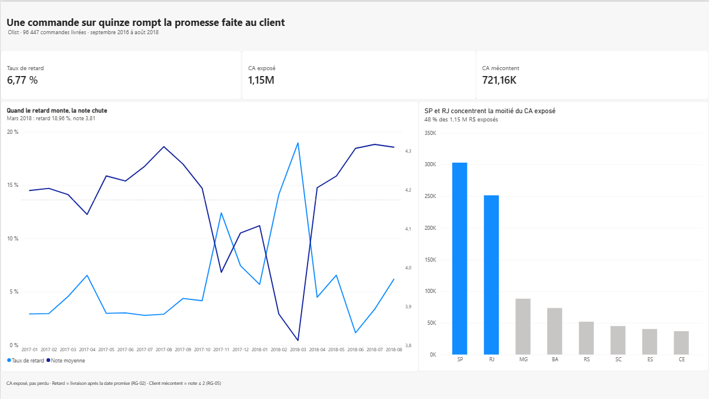
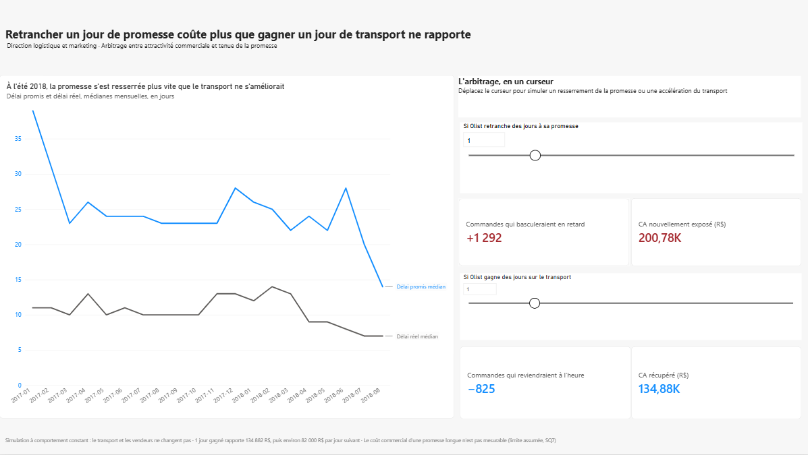

# 05. Dashboard Power BI

Restitution du projet en six pages. Chaque page s'adresse à une direction, et
son titre donne le message à retenir, pas seulement le sujet.

**Source des données.** Power BI est connecté à la base PostgreSQL, sur les
tables finales `mart.orders` et `mart.sellers`. Les données arrivent déjà
nettoyées et au bon grain : aucune transformation n'est faite dans Power BI,
seulement des mesures DAX.

**Fichiers.**

| Fichier | Contenu |
|---|---|
| [`olist_dashboard.pdf`](olist_dashboard.pdf) | Export des six pages |
| [`captures/`](captures) | Une capture par page |
| `olist_dashboard.pbix` | Fichier Power BI, non versionné (exclu par le `.gitignore`) |

---

## Les six pages

| # | Page | Message | Direction |
|---|---|---|---|
| 1 | Synthèse | Une commande sur quinze rompt la promesse faite au client | Direction générale |
| 2 | Où agir | Le retard naît du transport, et se concentre sur quelques états | Logistique |
| 3 | Client | Le client ne tolère aucun retard, et l'avance ne rapporte rien | Relation client |
| 4 | Les leviers | Retrancher un jour de promesse coûte plus que gagner un jour de transport ne rapporte | Logistique et marketing |
| 5 | Anticiper | Le modèle détecte deux fois plus de retards qu'une règle par état, mais se trompe encore neuf fois sur dix | Relation client |
| 6 | Vendeurs | Le taux de retard ne désigne pas les vendeurs à suivre, la date limite d'expédition oui | Partenariats vendeurs |

---

## Le simulateur (page Les leviers)

Deux curseurs, de 0 à 5 jours, chiffrent en direct les deux leviers d'Olist :

| Curseur | Ce qu'il simule | Ce qu'il affiche |
|---|---|---|
| Jours retranchés | Une promesse plus courte, transport inchangé | Commandes qui basculeraient en retard, chiffre d'affaires nouvellement exposé |
| Jours gagnés | Un transport plus rapide, promesse inchangée | Commandes qui reviendraient à l'heure, chiffre d'affaires récupéré |

**Fonctionnement.** Chaque curseur est un paramètre Power BI. Une mesure DAX
lit la valeur choisie, décale d'autant l'écart à la promesse de chaque
commande, puis recompte les commandes en retard. Toutes les autres conditions
restent inchangées.

**Lecture à un jour.** Retrancher un jour de promesse fait basculer 1 292
commandes en retard ; gagner un jour de transport en ramène 825 à l'heure.

---

## Les mesures DAX

22 mesures, regroupées par usage :

| Usage | Mesures |
|---|---|
| Volume et tenue de la promesse | Nb commandes, Taux de retard, Commandes en retard sur 96 447, Moyenne nationale |
| Délais | Délai promis médian, Délai réel médian, Durée à l'heure, Durée en retard |
| Client | Note moyenne, Taux d'insatisfaction, CA mécontent |
| Exposition | CA exposé |
| Simulateur | Retards supplémentaires, CA nouvellement exposé, Retards évités, CA récupéré |
| Modèle | Taux de détection, Fausses alertes |
| Vendeurs | Moyenne pondérée vendeurs, Taux de disparition, Couleur vendeur |
| Mise en page | Points clés |

---

## Conventions

- **Retard** : livraison après la date promise, en jours calendaires (RG-02).
- **Client mécontent** : note de 1 ou 2 (RG-05).
- **CA exposé** : chiffre d'affaires des commandes livrées en retard. C'est une
  exposition, pas une perte : avec 3,12 % de réachat, la perte future n'est pas
  mesurable.
- **Vendeurs** : au moins 10 commandes mono-vendeur livrées (RG-08, RG-09),
  soit 1 217 vendeurs.
